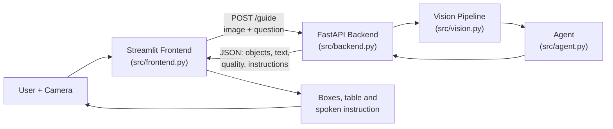
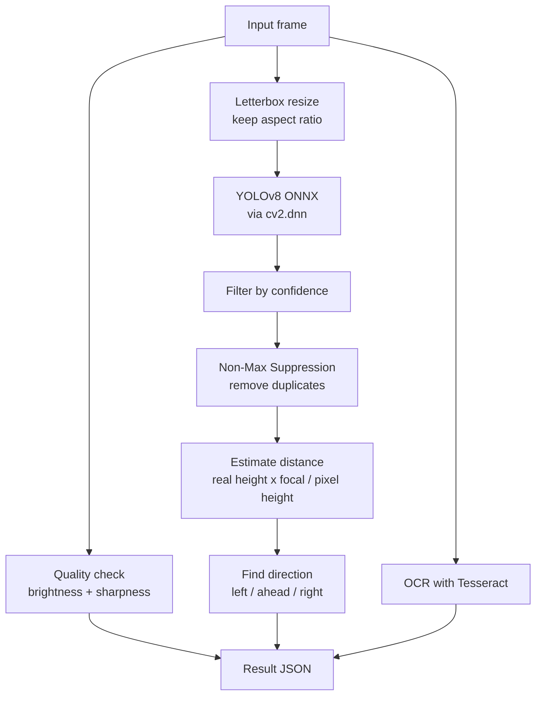
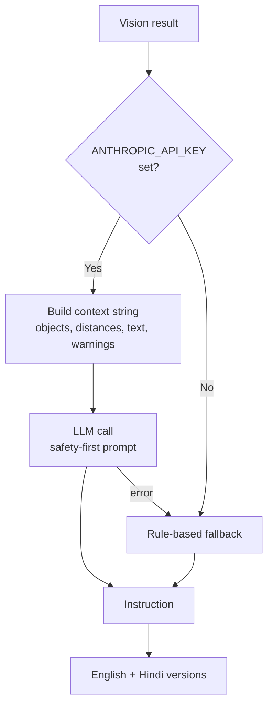
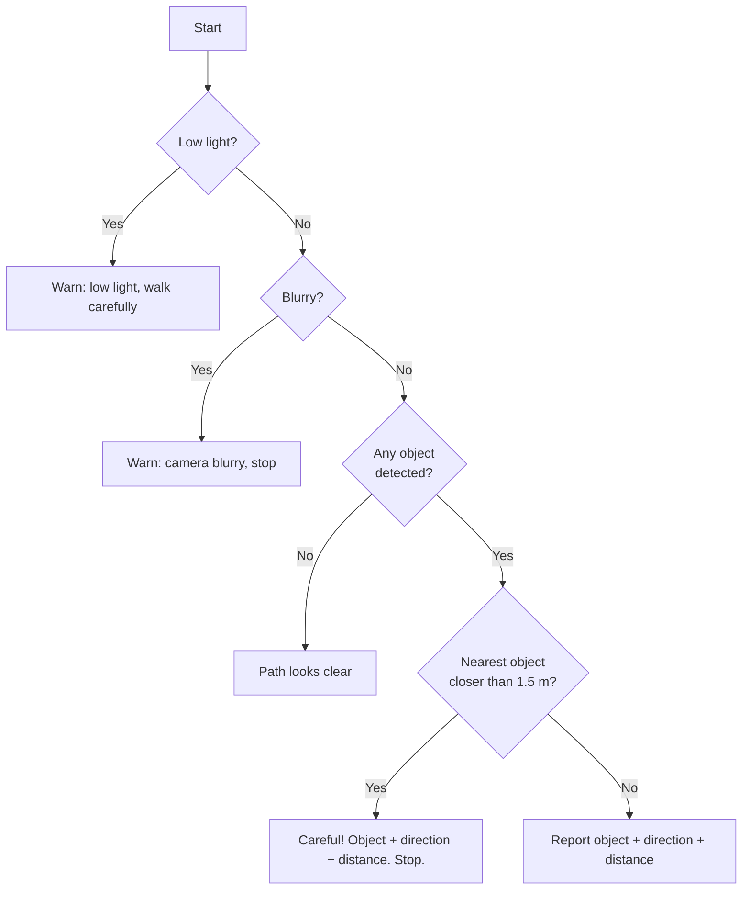
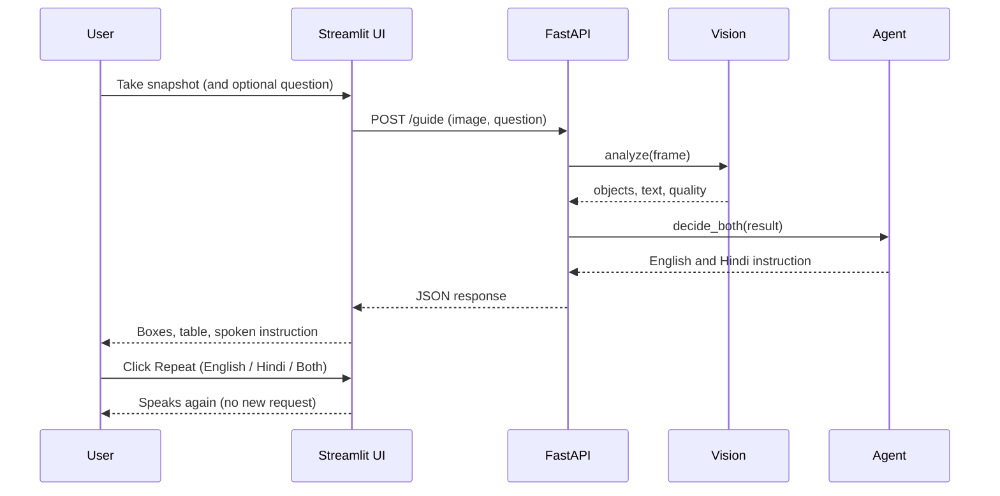
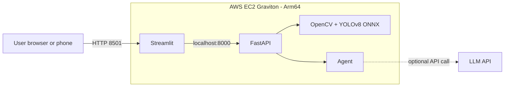

# 🦯 VisionPath AI

**An AI navigation assistant for visually impaired people.**
It looks through a camera, detects objects, estimates distance and direction, reads text, decides what the user should do, and speaks the instruction aloud in **English and Hindi**.

> ⚠️ VisionPath AI is an **assistive aid, not a replacement** for a white cane, a guide dog or human help. Distances are estimates.

---

## Table of Contents
1. [Motivation](#motivation)
2. [Features](#features)
3. [How It Works (Flow Diagrams)](#how-it-works-flow-diagrams)
4. [Tech Stack](#tech-stack)
5. [Project Structure](#project-structure)
6. [Installation](#installation)
7. [Running the Project](#running-the-project)
8. [API Reference](#api-reference)
9. [Configuration](#configuration)
10. [Calibration and Accuracy Tips](#calibration-and-accuracy-tips)
11. [Deploying on AWS Graviton](#deploying-on-aws-graviton)
12. [Responsible AI and Limitations](#responsible-ai-and-limitations)
13. [Troubleshooting](#troubleshooting)
14. [Roadmap](#roadmap)
15. [License](#license)

---

## Motivation
People who cannot see struggle to spot obstacles (chairs, vehicles, stairs), read signs, or find everyday items such as medicine. A cane only senses what is within arm's reach, and a helper is not always available.

VisionPath AI turns an ordinary camera into "eyes" and an AI agent into a "brain" that gives short, safety-first spoken guidance in the user's own language.

## Features
| Feature | Description |
|---|---|
| Object detection | YOLOv8 model running through OpenCV's `dnn` module (80 everyday object classes) |
| Distance estimation | Pinhole-camera formula using each object's real-world height |
| Direction | Each object is reported as **left**, **ahead** or **right** |
| Text reading (OCR) | Tesseract reads signs, labels and medicine names |
| Agentic decisions | An LLM (optional) or a rule-based fallback turns detections into advice |
| Bilingual voice | Instructions in English and Hindi, with Repeat buttons for each |
| Safety checks | Alerts for low light and blurry frames |
| Works offline of any API key | Rule-based fallback keeps the demo working |

## How It Works (Flow Diagrams)

### 1. End-to-end system flow


### 2. Vision pipeline (inside `vision.py`)


### 3. Agent decision flow (inside `agent.py`)


### 4. Rule-based priority (fallback logic)


### 5. User interaction sequence


## Tech Stack
- **Language:** Python 3.10+
- **Computer vision:** OpenCV (`dnn` module), NumPy, Pillow
- **Model:** YOLOv8 (exported to ONNX with Ultralytics)
- **OCR:** Tesseract via `pytesseract`
- **Backend:** FastAPI + Uvicorn
- **Frontend:** Streamlit (browser speech synthesis for voice)
- **LLM (optional):** Anthropic Claude API
- **Cloud (optional):** AWS EC2 Graviton (Arm)

## Project Structure
```
visionAi/
├── src/
│   ├── vision.py          # detection, distance, direction, OCR, quality checks
│   ├── agent.py           # LLM / rule-based decisions, English + Hindi
│   ├── backend.py         # FastAPI server (/health, /analyze, /guide)
│   └── frontend.py        # Streamlit dashboard + voice + repeat buttons
├── checks/
│   └── phase1_webcam.py   # live webcam test with OpenCV window
├── models/
│   └── yolov8n.onnx       # model used by the app (created by export_model.py)
├── config/                # reserved for future settings
├── export_model.py        # one-time: converts YOLO weights to ONNX
├── requirements.txt
├── .gitignore
└── README.md
```

## Installation

### 1. Clone and create a virtual environment
```bash
git clone https://github.com/<your-username>/visionAi.git
cd visionAi
python -m venv venv
```
Activate it:
- Windows (PowerShell): `venv\Scripts\Activate.ps1`
- Windows (CMD): `venv\Scripts\activate`
- Mac / Linux: `source venv/bin/activate`

### 2. Install Python libraries
```bash
pip install -r requirements.txt
```

### 3. Install Tesseract (for OCR)
Tesseract is a separate program, not a pip package.
- **Windows:** https://github.com/UB-Mannheim/tesseract/wiki (add it to PATH)
- **Ubuntu:** `sudo apt install tesseract-ocr tesseract-ocr-hin`
- **Mac:** `brew install tesseract`

If Tesseract is missing the app still runs; text reading just returns empty.

### 4. Create the model (one time)
Model files are large and are **not** stored in Git.
```bash
python export_model.py
```
Then move the generated file into `models/`:
```bash
# Windows
move yolov8n.onnx models\
# Mac / Linux
mv yolov8n.onnx models/
```
> Using a larger model (`yolov8s`, size 960) gives better detection but is slower. If you change the model, update `MODEL_PATH` and `size` in `src/vision.py` so they match the export.

## Running the Project
Always run commands from the project root with the virtual environment active.

| Purpose | Command |
|---|---|
| Webcam test (Phase 1) | `python checks/phase1_webcam.py` (press `q` to quit) |
| Backend (Terminal 1) | `uvicorn backend:app --app-dir src --port 8000` |
| Frontend (Terminal 2) | `streamlit run src/frontend.py` |

Steps:
1. Start the backend and wait for `Application startup complete.`
2. Check http://127.0.0.1:8000/health returns `{"status":"ok"}`.
3. Start the frontend, click **Take photo**, and listen to the instruction.
4. Use **🔁 English / 🔁 हिन्दी / 🔁 Both** to hear it again.

> `src/backend.py` must use plain imports (`from vision import ...`), not relative imports (`from .vision import ...`), because it is started with `--app-dir src`.

## API Reference
Interactive docs: http://127.0.0.1:8000/docs

| Method | Endpoint | Input | Output |
|---|---|---|---|
| GET | `/health` | none | `{"status": "ok"}` |
| POST | `/analyze` | `file` (image), `ocr` (bool) | objects, text, quality |
| POST | `/guide` | `file` (image), `language`, `question` | everything above plus `instructions` (English + Hindi) |

Example `/guide` response:
```json
{
  "objects": [
    {"label": "chair", "confidence": 0.82, "distance_m": 1.2,
     "direction": "left", "box": [40, 210, 120, 260]}
  ],
  "text": "EXIT",
  "quality": {"brightness": 112.4, "sharpness": 240.1, "warnings": []},
  "instructions": {
    "English": "Careful! chair left, only 1.2 metres. Please stop.",
    "Hindi": "सावधान! बाईं ओर कुर्सी सिर्फ 1.2 मीटर दूर है। रुकिए।"
  }
}
```

## Configuration
| Setting | Where | Default | Meaning |
|---|---|---|---|
| `ANTHROPIC_API_KEY` | environment variable | not set | Enables LLM decisions; without it, rules are used |
| `VISIONPATH_API` | environment variable | `http://127.0.0.1:8000` | Backend URL used by the frontend |
| `conf` | `Detector(...)` | 0.25 to 0.3 | Minimum detection confidence |
| `size` | `Detector(...)` | 640 (960 for `yolov8s`) | Model input size, must match the export |
| `FOCAL_PX` | `src/vision.py` | 600 | Camera focal length in pixels (calibrate) |

Setting the API key (never commit it):
```powershell
# Windows PowerShell
$env:ANTHROPIC_API_KEY="your_key_here"
```
```bash
# Mac / Linux
export ANTHROPIC_API_KEY=your_key_here
```

## Calibration and Accuracy Tips
**Distance calibration** (recommended once per camera):
1. Place a person (about 1.7 m tall, full body in view) exactly 2 m from the camera.
2. Note the box height in pixels (`box[3]`).
3. Set `FOCAL_PX = box_height * 2.0 / 1.7` in `src/vision.py`.

**Better detection:**
- Use good, even lighting and keep the camera steady.
- Keep objects fully in view, 1 to 3 metres away.
- Use `yolov8s` with a larger input size for small or far objects.
- Distance is only accurate when the **whole object** is visible (a head-and-shoulders view makes a person look farther away).

## Deploying on AWS Graviton
1. Launch an **Ubuntu 22.04 ARM64** EC2 instance (for example `t4g.medium`). Open ports 22, 8000, 8501 in the security group.
2. Install system packages:
   ```bash
   sudo apt update
   sudo apt install -y python3-venv python3-pip tesseract-ocr tesseract-ocr-hin libgl1
   ```
3. Copy or clone the project, then:
   ```bash
   python3 -m venv venv && source venv/bin/activate
   pip install -r requirements.txt
   python export_model.py && mkdir -p models && mv yolov8n.onnx models/
   nohup uvicorn backend:app --app-dir src --host 0.0.0.0 --port 8000 &
   VISIONPATH_API=http://localhost:8000 nohup streamlit run src/frontend.py --server.port 8501 &
   ```
4. Open `http://<ec2-public-ip>:8501`.

Measure and report milliseconds per frame on Arm and compare cost with an x86 instance.



## Responsible AI and Limitations
- **Not a safety device:** use together with a cane, guide dog or human support.
- **Estimated distances:** they depend on camera calibration and object size assumptions.
- **Limited object set:** the model knows 80 everyday classes. Stairs, doors, curbs and medicine strips need a custom-trained model.
- **Lighting and blur:** the app warns the user when the image is too dark or blurry.
- **Privacy:** images are processed per request and **not stored**. If the LLM option is enabled, only a text description of detections (not the image) is sent.
- **Language voices:** Hindi speech needs a Hindi voice on the device (Microsoft Edge on Windows works well).

## Troubleshooting
| Problem | Fix |
|---|---|
| `ImportError: attempted relative import` | Remove the dot: `from vision import ...` in `src/backend.py` |
| `Can't read ONNX file` | Check `dir models`; the model must exist and match `MODEL_PATH` and `size` |
| Streamlit `ConnectionError ... 10061` | The backend is not running; start Uvicorn first |
| `KeyError: 'instruction'` | Frontend and backend versions differ; the API now returns `instructions` |
| Hindi voice is slow or silent | Install the Hindi voice in Windows and use Edge |
| OCR returns empty text | Install Tesseract and add it to PATH |
| Objects missed | Improve lighting, lower `conf`, or use `yolov8s` at size 960 |

## Roadmap
- [ ] Live video streaming with `streamlit-webrtc`
- [ ] Voice input for questions ("Where is my medicine?")
- [ ] Custom model for stairs, doors, curbs and medicine strips
- [ ] Mobile-friendly app
- [ ] Depth camera or monocular depth model for better distance
- [ ] More Indian languages

## License
Add a license of your choice (for example MIT) by creating a `LICENSE` file.
Note: Ultralytics YOLOv8 is released under AGPL-3.0; review its license terms before any commercial use.

## Acknowledgements
OpenCV, Ultralytics YOLOv8, FastAPI, Streamlit, Tesseract OCR, Anthropic.
